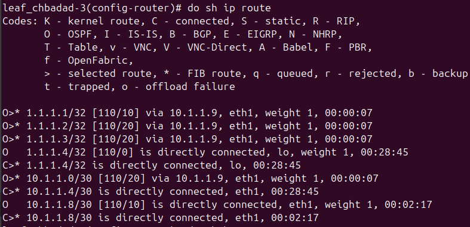
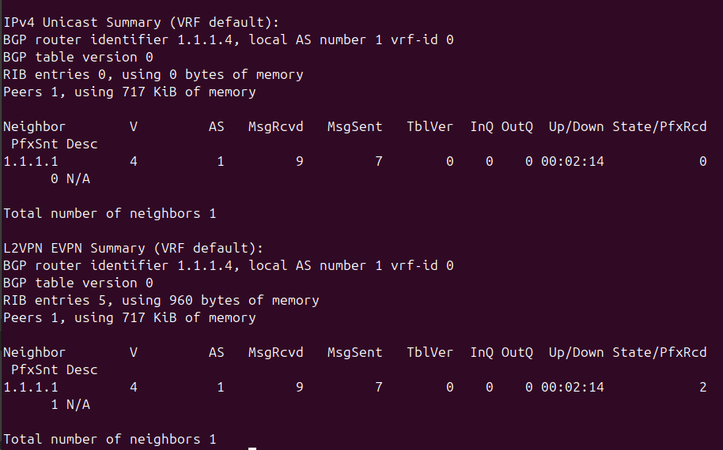
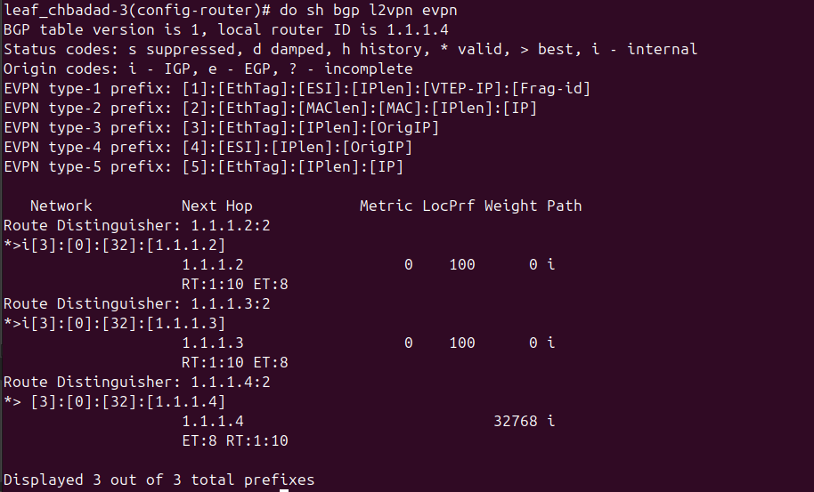
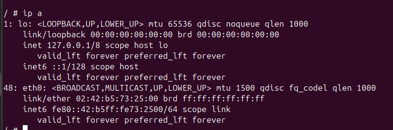
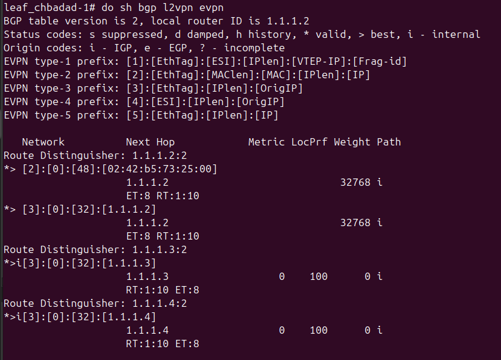
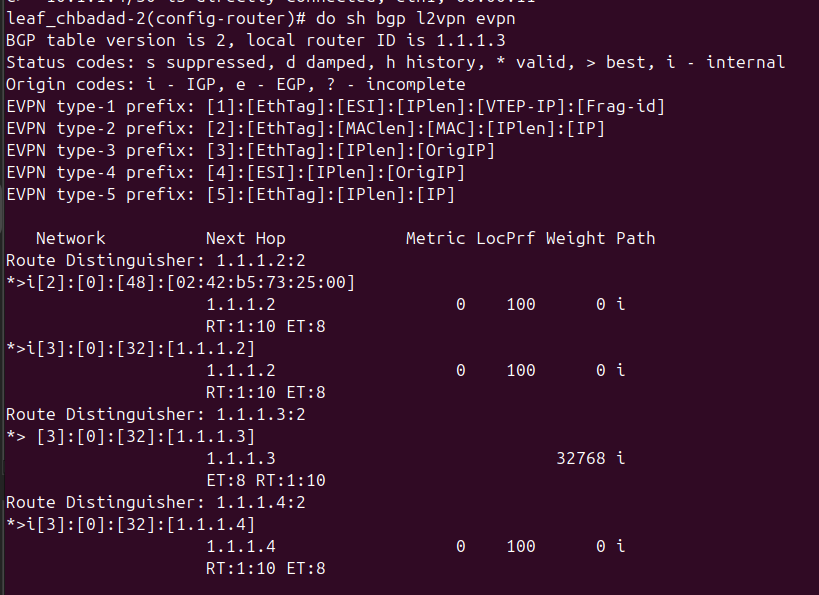
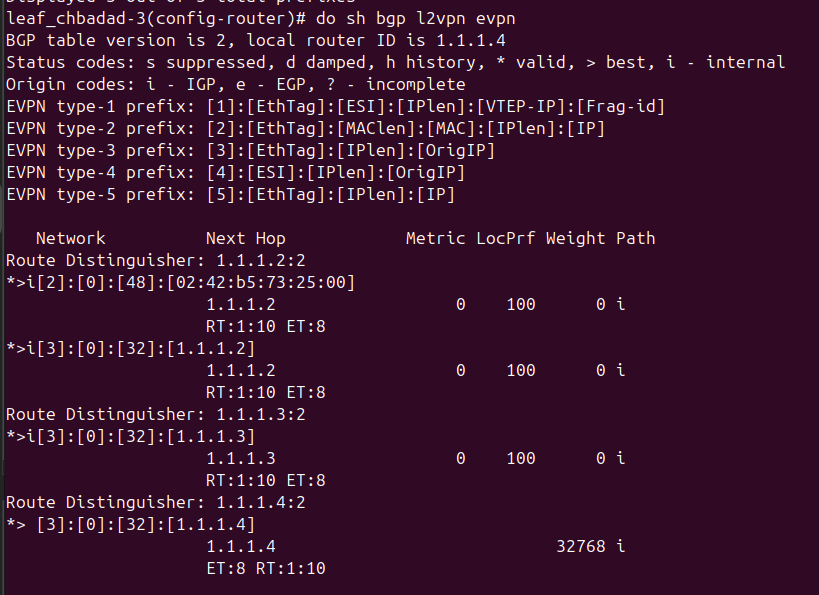
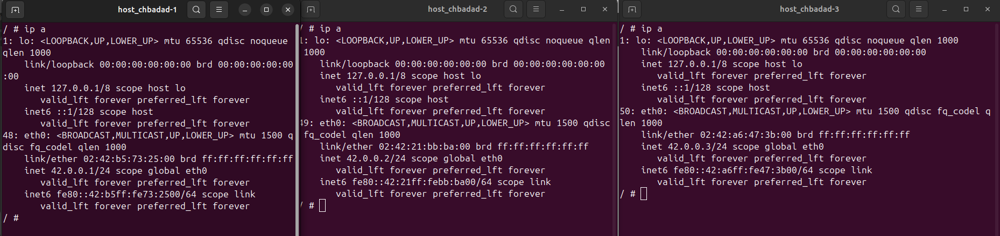
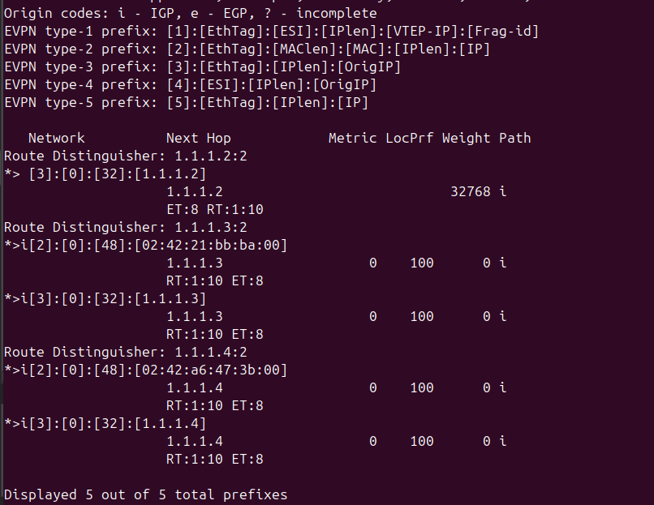
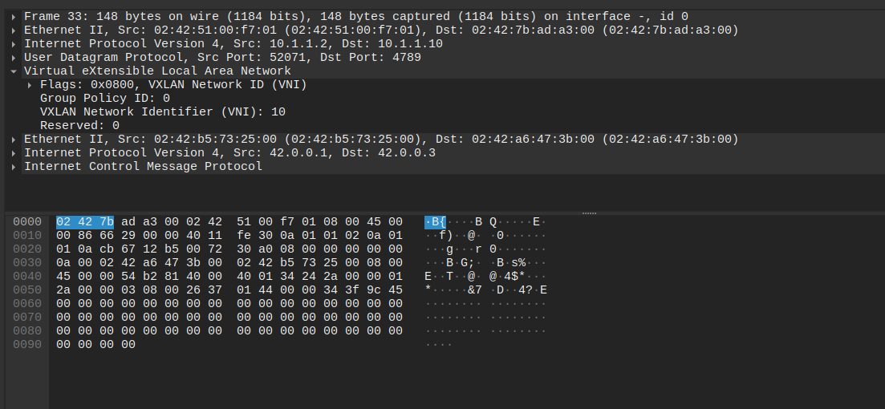

# Part 3

This part is about discovering BGP EVPN's application to VXLAN. Our case is a small data center.

**VXLAN** is the [data plane](https://www.cloudflare.com/learning/network-layer/what-is-the-control-plane/) or also forwarding plane.

**BGP EVPN** is the [control plane](https://www.ibm.com/think/topics/control-plane) that defines and controls how data is forwarded in the network.

> 💡 We are not interested in eBGP, but only in iBGP, which is used within an AS to connect internal routers. However, we could use eBGP by simulating two ASes using private AS numbers (range 64512–65534) without making any announcements to the Internet.

## Table of Content

- [Requirements](#requirements)
- [Conventions and Best Practices](#-conventions-and-best-practices)
- [Walkthrough](#walkthrough)
    1. [Set up GNS3](#1-set-up-gns3)
    2. [Create the network](#2-create-the-network)
    3. [Save the project](#3-save-the-project)
- [Defense](#defense)
- [Resources](#resources)

## 💡 Conventions and Best Practices

### More about loopback interfaces

Creating a **loopback interface with a routable IP for a VTEP** is considered a good practice:

- Loopback interfaces **are always up** as long as the device is running, unlike physical interfaces that may go down. This means they are not tied to a specific physical port, so they remain reachable regardless of link/interface state changes.
- It ensures a stable VTEP identifier for protocols such as BGP (they use the source IP as identifier).
- Same for the OSPF router ID which is the loopback IP address too.

Why `/32` for loopbacks? Because:

- The loopback only communicates with itself—no need for neighbors in the same subnet.
- Protocols like OSPF, BGP, and IS-IS prefer routing to a unique IP.

Always plan a dedicated subnet from a private range for loopback addresses. These are used as Router IDs (RID) by OSPF, reducing the risk of duplication.

## Requirements

The project run inside a Linux virtual machine that must have installed:

- GNS3
- Docker

Follow this guide: [GNS3 Linux Install](https://docs.gns3.com/docs/getting-started/installation/linux/).

## Walkthrough

### 1. Set up GNS3

1. Start GNS3.

2. Create a new project named `P3` as required by the assignment.

### 2. Create the network

1. From the device list, drag and drop the four routers and the three hosts to match the assignment schema.

```bash
vtysh # sert a rentrer dans le shell de frrouting
configure t # sert a rentrer dans le mode de configuration
```

```bash
ip a add 42.0.0.1/24 dev eth1 #sert a donner une adresse ip a une interface 
```

```bash
do sh ip route # sert a montrer les routes sur un vtep par ex. pour voir les types (2 ou 3)
```

Voici une configuration correcte **avant** d'activer les hotes.



```bash
do sh bgp summary # sert a montrer le statut actuel de bgp sur une leaf donnees.
```

Nous pouvons constater ci-dessous que nous n'avons que la route vers le route reflector de configuree (un seul voisin), ce qui est normal. Si c'etait via un design full mesh - ouest entre en dur les relations de voisinage - ce serait probablement different.



```bash
do sh bgp l2vpn evpn # donne les details de bgp/evpn
```

Grace a la commande ci-dessus, nous pouvons constater qu'il **n'y a pas** de route de type 2 (avec les adresses mac). C'est normal. NOus avons seulement pour l'instant les routes de type 3, representees par le i[3] :



Si nous demarrons l'hote host_chbadad-1, nous pouvons voir ci-dessous qu'il n'y a pas d'adresse IP assignee a eth0 :



Il y a cependant une adresse MAC (`02:42:b5:73:25:00`).

Si nous regardons la leaf leaf_chbadad-2, nous pouvons voir qu'elle a appris la route de type 2 qui la relie a cet hote :



L'adresse mac est effectivement la meme.

Qu'en est-il des autres leafs ?

Vu que le but du plan de controle represente par le route reflector et evpn est de "faire apprendre" ces routes, logiquement ces routes de type 2 doivent etre automatiquement refletees sur les autres vtep.

Regardons sur la leaf leaf_chbadad-2 :



Et enfin regardons sur la leaf leaf_chbadad-3 :



Tout semble en ordre !

Maintenant, nous pouvons attribuer une adresse IP a notre hote afin de verifier sa connectivite avec les autres hotes, pour lesquel nous allons faire de meme.

```bash
ip a add 42.0.0.1/24 dev eth0
```

Voici le resultat :



Maintenant nous pouvons tester un ping sur un des deux autres hotes.

Cela devrait fonctionner car par exemple, si nous voulons pinguer l'hote 3, celui-ci aura "donne" son adresse mac a leaf-4 (une decouverte du voisinage normale) qui aura donne l'information au route reflector, qui se chargera de transmettre cette nouvelle donnee aux differentes leaf qui sont connectees a lui.

Regardons par exemple si l'adresse MAC de host_chbadad-3 (`02:42:a6:47:3b:00`) a bien ete apprise par leaf_chabadad-1 :



C'est effectivement le cas.

Donc si nous faisons un ping du host_chbadad-1 (42.0.0.1) vers host_chbadad-2 (42.0.0.2), nous pouvons voir au niveau de la liaison entre leaf-1 et le RR le paquet encapsule, exactement de la meme facon que dans la P2, a l'exception pres que nous avons egalement le routage sur la couche IP (underlay) via OSPF :


Ci-dessous nous constatons bien un paquet icmp encapsule via vxlan, comme dans la P2 :



### 3. Save the project

Since the changes won't persist after the devices stop, create Shell scripts for configuring routers.

The project must be saved as a ZIP archive. In the menu bar, click `File` > `Export portable project`. Don't forget to include the base images to match the requirements.

## Defense

The [`docker` directory](/docker/) contains a Dockerfile for the routers based on FRR's with the configuration scripts.

## Resources

- [VXLAN: BGP EVPN with FRR](https://vincent.bernat.ch/en/blog/2017-vxlan-bgp-evpn)
- [🎥 Bgp evpn with Linux and FRR | Hands on experience of networking | EVPN hands on with Linux and FRR](https://www.youtube.com/watch?v=_DO_SEm73pQ)
- [🎥 GNS3: FRRouting Using Docker Platform - EVPN](https://www.youtube.com/watch?v=Ek7kFDwUJBM)
